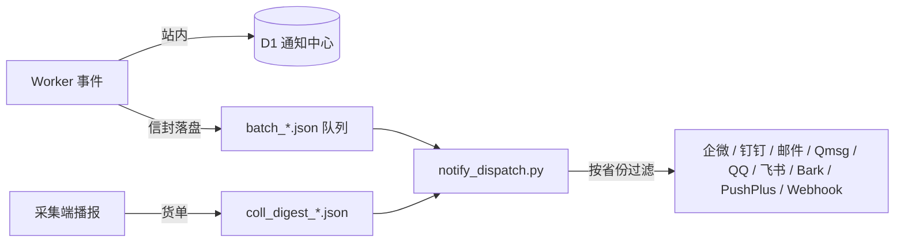

<div align="center">

# ChinaMNOs

**运营商公开资费聚合 · 变更监控 · 号卡市集**

自动采集中国移动 / 中国联通 / 中国电信 / 中国广电官网公开资费与公告，
提供变更对比与社区服务。

[](https://chinamnos.ftac.dpdns.org/)
[](LICENSE)


</div>

> [!IMPORTANT]
> 仅供学习研究使用。所有数据均来自运营商官方网站公开渠道，本站不保证数据实时性与准确性，不构成任何消费建议。

---

## 功能总览

| 模块 | 能力 |
|---|---|
| **资费中心** | 四运营商官网公开资费自动采集（多线程 + 分级重试）、套餐变更对比、公告采集、Playwright 过盾回退、波动保护与假清空核验 |
| **跳蚤市集** | 配置驱动板块（求购/出让/出租/求租）、发布审核、在线沟通、交易凭证、车队板块、收藏/置顶 |
| **工单中心** | 卡商担保人申请、站内工单沟通、工单模板 |
| **觅珍集库** | 链接收录（审核制）、活动攻略投稿（Markdown + 图床外链 + 活动二维码）、社群收录 |
| **公告推广** | 全站公告、模块级弹窗（按资费/市集/工单/工具作用域投放）、强制同意门控 |
| **用户体系** | 注册登录（密钥派生 + 会话签名）、Turnstile 人机校验、邮箱验证 / 密码找回 / 换绑（Resend） |
| **通知系统** | 站内通知中心 + 站外推送（企业微信 / 钉钉 / 邮件 / Qmsg / QQ 官方机器人 / 飞书 / Bark / PushPlus / 自定义 Webhook）、采集播报按省份订阅 |
| **容灾部署** | Cloudflare Pages / EdgeOne Pages / GitHub Pages 多线路组合，前端自动跳线守卫 |
| **边缘缓存** | 公开接口 Cache API 缓存 + 公共配置静态化，降低 Worker 配额消耗 |

<!-- 截图位：将截图放入 docs/ 目录后取消注释
| 资费中心 | 跳蚤市集 |
|---|---|
|  |  |
-->

---

## 线上站点使用指南

无需自行部署，直接访问 **[chinamnos.ftac.dpdns.org](https://chinamnos.ftac.dpdns.org/)** 即可使用以下全部功能：

| 功能 | 入口 | 说明 |
|---|---|---|
| 查询资费 | [资费中心](https://chinamnos.ftac.dpdns.org/#/) | 按运营商 / 省份 / 套餐类型筛选，查看最新采集结果与历史变更对比 |
| 订阅变更播报 | 登录后右上角用户菜单 →「通知配置」 | 绑定企业微信 / 钉钉 / 邮件 / Qmsg / QQ 官方机器人 / 飞书 / Bark / PushPlus / 自定义 Webhook 渠道，按运营商与省份设置关注范围，每轮采集结束后推送关注范围内的资费变更摘要 |
| 号卡交易 | [跳蚤市集](https://chinamnos.ftac.dpdns.org/#/cardhub) | 浏览或发布求购 / 出让信息，站内沟通，担保人机制保障交易 |
| 活动与攻略 | [觅珍集库](https://chinamnos.ftac.dpdns.org/#/tools) | 优质链接收录与活动攻略，支持 Markdown 投稿 |
| 问题反馈与工单 | [工单中心](https://chinamnos.ftac.dpdns.org/#/ticket) | 反馈站内问题与建议，卡商担保人申请等事务通过工单跟进处理 |

数据由后台定时任务自动采集更新。站内注册后即可使用订阅、发帖、工单等完整功能；未登录状态可浏览资费、公告与公开板块。

---

## 项目架构与运行方式

了解本项目如何运转不需要实际部署，本节面向所有读者。

### 整体架构

```
┌─────────────┐    采集+部署     ┌──────────────────────┐
│ 采集端       │ ───────────────▶ │ 静态站（前端+数据）    │
│ chinamnos.py │  CF Pages /     │ Cloudflare Pages      │
│ (青龙面板)   │  EdgeOne / GH   │ EdgeOne Pages (多线路) │
└──────┬──────┘                 └──────────┬───────────┘
       │ 播报货单 coll_digest_*.json        │ /api/*（自定义域）
       ▼                        ┌──────────▼───────────┐
┌─────────────┐   拉订户名单     │ Cloudflare Worker     │
│ 通知分发      │ ◀────────────── │ D1 (数据) + R2 (凭证)  │
│ notify_      │                 │ 站内通知 / 队列落盘     │
│ dispatch.py  │ ──▶ 钉钉/企微/邮件│ （batch_*.json 文件队列）│
└─────────────┘                 └──────────────────────┘
```

### 组件说明

| 组件 | 代码位置 | 职责 |
|---|---|---|
| **采集端** | `chinamnos.py` | 单文件 Python 脚本，运行于青龙面板定时任务；负责资费/公告采集、变更对比、多线路存储编排、前端联合部署、采集播报货单落盘 |
| **后端** | `worker/` | Cloudflare Worker（TypeScript）；提供用户/帖子/工单/活动/公告/通知 API，D1 数据库 + R2 附件存储，内置定时清理任务 |
| **通知分发** | `qinglong/notify_dispatch.py` | 运行于青龙侧的批量分发脚本，消费通知队列与采集播报货单，仅依赖标准库 |
| **前端** | `pages-dist/` | 原生 JavaScript SPA（零构建），由采集端联合部署或从 GitHub 仓库拉取 |

### 数据流转

1. **采集**：青龙定时触发采集端，抓取四运营商官网公开资费与公告，产出符合 `snapshot.schema.json` / `changelog.schema.json` / `stats.schema.json` 规范的数据文件
2. **发布**：采集端将数据与前端文件一并推送至多条静态线路（Cloudflare Pages / EdgeOne Pages / GitHub Pages），`index.html` 中的 `__ROUTES__` 占位符在部署时注入线路清单，前端容灾守卫在主线路不可用时自动切换
3. **交互**：前端通过自定义域调用 Worker API，完成注册登录、发帖、工单等动态功能；公开只读接口经 Cache API 边缘缓存以降低配额消耗
4. **通知**：Worker 将站外通知组装为信封文件落盘为队列，分发脚本按用户订阅偏好（渠道 + 省份）推送；详见下文[通知系统](#通知系统)

### 目录结构

```
├── chinamnos.py               # 采集端（单文件，青龙运行）
├── chinamnos_updater.sh       # 青龙更新执行器：任务启动时自动从 GitHub 拉取最新脚本再执行
├── qinglong/
│   ├── notify_dispatch.py     # 通知分发脚本（与 chinamnos.py 同目录部署）
│   └── payload_sample.json    # 通知 payload 示例
├── worker/                    # Cloudflare Worker 后端
│   ├── src/                   #   TypeScript 源码（auth/cardhub/tickets/activities/notify/mail/common…）
│   ├── migrations/            #   D1 数据库迁移（0001→0044）
│   └── wrangler.toml.example  # 部署配置模板（复制为 wrangler.toml 填写）
├── pages-dist/                # 前端（原生 JS，无构建）
│   ├── shell/                 #   布局与公共层（api/auth/notice/notify/markdown/主题…）
│   ├── modules/               #   tariff 资费 / cardhub 市集 / ticket 工单 / tools 工具 / config 配置 / admin 后台
│   └── frontend-config.js     #   模块注册表（路由与版本号）
├── snapshot.schema.json 等    # snapshot / changelog / stats 数据格式参考
└── serve.cjs                  # 本地前端预览（端口 3000）
```

---

## 通知系统

通知分两条链路，渠道适配器在 Worker 与分发脚本两侧同构注册（新增渠道各加一个函数即可）：



- **站内通知**：Worker 直写 D1，用户在前端通知中心查看（列表 / 已读 / 删除 / 清理已读）
- **站外推送**（企业微信 / 钉钉 Webhook、SMTP 邮箱池、Qmsg、QQ 官方机器人、飞书、Bark、PushPlus、自定义 Webhook）：
  1. 用户在「通知配置」（登录后右上角用户菜单）绑定渠道并完成验证，可按通知类别与关注省份设置订阅偏好
  2. Worker 按统一消息模板组装信封，以 `batch_*.json` 文件落盘为队列（经青龙 OpenAPI 写入脚本目录，文件即队列）
  3. `notify_dispatch.py` 定时扫描队列：flock 防并发 → 按通知 ID 去重 → 逐行分发（行内重试）→ 消化后删除；失败行进入失败清单，脚本以非零码退出时由青龙自带失败通知兜底提醒站长
- **采集播报**：采集端每轮把变更明细写成 `coll_digest_*.json` 货单（落在 `notification.digest_dir`）；分发脚本发现货单后调用 Worker 内部端点（`DIGEST_PULL_TOKEN` 鉴权）拉取订户名单，按每人关注省份抽取明细、组装「本轮明细 + 今日累计」消息发送，并以 `collector_digest:{uid}:{轮次}:{绑定行ID 或渠道类型}` 防重发

---

<details>
<summary><h2>自部署指南（面向自托管用户，点击展开）</h2></summary>

### 前置要求

- Cloudflare 账号（Workers / D1 / R2 / Pages）
- 一台可运行 [青龙面板](https://github.com/whyour/qinglong) 的环境（NAS / VPS 均可），用于执行采集与通知分发
- 一个自有域名（workers.dev 在大陆受 DNS 污染，API 需绑定自定义域）

### Step 1 · 部署后端（Cloudflare Worker）

```bash
cd worker
npm install
npx wrangler login
cp wrangler.toml.example wrangler.toml   # 填入你的 D1/R2 资源 ID、自定义域与变量

npx wrangler d1 create <数据库名>          # 创建后把 id 填回 wrangler.toml
npx wrangler r2 bucket create <桶名>
npx wrangler d1 migrations apply <数据库名> --remote

npx wrangler secret put RESEND_API_KEY    # Resend 邮件 API Key
npx wrangler secret put CARDHUB_SECRET    # 32 字节随机十六进制（会话签名/联系方式加密）
npx wrangler secret put TURNSTILE_SECRET  # Cloudflare Turnstile 服务端密钥
npx wrangler secret put DIGEST_PULL_TOKEN # 采集播报订户名单端点密钥（与分发脚本侧同值）

npx wrangler deploy
```

> [!TIP]
> 如需启用 Worker 内置定时任务（过期数据清理、市集/活动定时状态流转），在 `wrangler.toml` 中追加：
>
> ```toml
> [triggers]
> crons = ["0 9 * * *"]
> ```

### Step 2 · 配置采集端（青龙面板）

1. 把 `chinamnos_updater.sh` 上传到青龙脚本目录，新建定时任务：`task chinamnos_updater.sh`
   —— 之后每次任务启动都会自动从 GitHub 拉取最新 `chinamnos.py` 与 `qinglong/notify_dispatch.py`
   （多源加速 + 完整性校验 + 旧版备份，`SKIP_UPDATE=1` 可跳过更新）
2. 通过青龙环境变量 `TARIFF_CONFIG` 注入完整 JSON 配置。可使用站点内置的[配置生成工具](https://chinamnos.ftac.dpdns.org/#/config)在线填写并导出配置 JSON，再写入青龙环境变量；也可按青龙方式直接写入 `config.json`
3. 再建一个分发任务：`python3 notify_dispatch.py`（轮询通知队列，建议与采集任务错峰；未配置通知渠道时可暂不启用）

常用参数（原样透传给 `chinamnos.py`）：

```bash
task chinamnos_updater.sh                     # 完整采集
task chinamnos_updater.sh --init              # 初始化基线（不通知）
task chinamnos_updater.sh --announce-only     # 仅公告采集（轻量轮）
task chinamnos_updater.sh --rebuild-stats     # 从已有快照重建 stats
task chinamnos_updater.sh --deploy-frontend   # 仅部署前端
```

> [!NOTE]
> Python 依赖：`requests`、`pycryptodomex`（可选：`playwright-chromium`，用于电信公告过盾回退）。
> 通知分发脚本仅依赖标准库。

### Step 3 · 前端

前端随采集端**联合部署**：每次采集把 `storage.frontend_source.frontend_dir` 目录下的文件一并推送到各线路，全量替换。

前端文件来源（`storage.frontend_source.mode`）四档：

| 模式 | 行为 |
|---|---|
| `github_prefer`（默认） | 每次部署前从 GitHub 仓库拉取最新前端，失败回落本地目录 |
| `local_only` | 只读本地目录，不做拉取 |
| `local_prefer` | 本地目录有内容用本地，为空才拉取 |
| `github_only` | 必须拉取成功，失败则本轮前端部署报错 |

> [!NOTE]
> 把 `pages-dist/` 推到你自己的 GitHub 仓库，青龙端即可免手动同步前端文件；
> `index.html` 中的 `__ROUTES__` 占位符由采集端部署时注入线路清单，保持原样提交即可。

### 本地开发

```bash
node serve.cjs              # 前端预览：http://localhost:3000（no-cache，改动即刷新）
cd worker && npm run dev    # Worker 本地调试（wrangler dev）
```

### 配置说明

采集端完整配置通过 `TARIFF_CONFIG` 环境变量（JSON）注入，主要分段：

| 分段 | 说明 |
|---|---|
| `storage` | 多线路存储编排（primary + backends 任意组合启用）、前端文件来源（`frontend_source`）、本地缓存 / 部署清单缓存 |
| `crawl` | 分页模式、重试（指数退避 + 抖动）、分类/翻页间隔、UA 池 |
| `carriers.<key>` | 各运营商开关、采集分类、公告采集、省份并发度覆盖、波动阈值、通知范围 |
| `announce` | 运营商公告采集（可独立于资费单独启用） |
| `schedule` / `notification` | cron 展示值、变更通知开关、`digest_dir`（分发脚本/货单统一工作目录，留空 = 脚本所在目录）、`smtp_accounts`（SMTP 发信邮箱池） |

各线路必填项、Turnstile 白名单（需包含所有启用线路的域名）等细节参见 `worker/wrangler.toml.example` 内注释与站点配置页字段提示。

</details>

---

## 免责声明

1. 本项目采集的数据均来自运营商官方网站公开渠道，仅作信息聚合展示，请以运营商官方渠道为准
2. 采集行为仅限低频请求并遵循公开页面访问规则；请使用者自行评估并承担使用本项目带来的风险
3. 跳蚤市集等社区板块内容由用户发布，站点部署者应履行审核义务，本项目作者不对用户发布内容负责
4. 请勿将本项目用于任何违反法律法规或运营商服务条款的用途

## License

[MIT](LICENSE)
